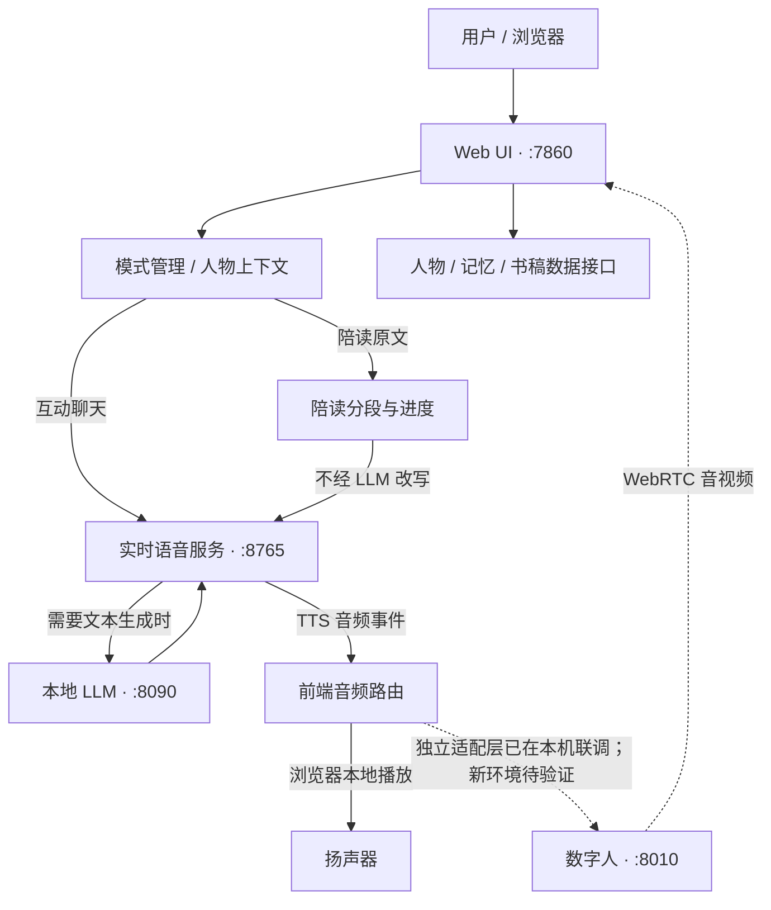

# AI Girlfriend · 本地 AI 女友

**一个以本地大语言模型为核心，整合实时语音交互、人物设定、智能陪读、可切换语音合成和 WebRTC 数字人的模块化 AI 陪伴项目。**

> **当前仓库状态：源码整理版 / 非一键运行发行版。** 本仓库保留经过隐私筛选的工程源码、第三方代码归属记录与部署说明，**不是完整生产环境的复制品**。数字人前端同步适配层 `runtime/ui/app/avatar-sync.js` 已随仓库发布，但它是**基于本仓库可授权材料重新实现的独立版本**，与原私有生产版本并非同一份代码：会话、投递、取消、阅读播放这些都是有的，也跑过离线契约测试，但**2026-10-13 已在本机既有 8010 数字人环境完成 T1–T6 真实联调（据本机执行报告）**，包括 WebRTC 音视频、口型跟随、陪读、停止/取消和会话释放；但尚未经过全新设备独立部署验收，也不能据此承诺与原私有版完全等效。模型权重、人物、声音、书库和个人记录不随源码提供。详见[真实验收记录](docs/AVATAR_SYNC_REAL_ACCEPTANCE_20261013.md)。请先阅读[当前发布范围](#当前发布范围与可用性)和[安装说明](docs/INSTALL.md)。

**项目状态（2026-10-13）**

| 项目 | 当前情况 |
| --- | --- |
| GitHub 仓库 | **公开（PUBLIC）**，开发预览源码，不是完整可安装发行版 |
| 内容定位 | 已筛选的源码与技术文档，不是安装即用的产品包 |
| 本地正式项目 | 存在独立生产环境；部分功能已在该环境的特定测试范围内验收 |
| 本仓库独立运行验收 | **数字人适配层已在本机既有数字人服务完成真实联调；全新安装及整个应用验收未完成** |
| 数字人前端适配 | **独立替代实现已包含；五组离线测试及本机 T1–T6 真实联调通过（据执行报告）** |
| 模型权重与人物素材 | **不包含，需要使用者自行准备并遵守相应许可** |
| 自研代码许可 | MIT；第三方代码**分别遵守各自许可证**，详见 [LICENSE](LICENSE) 与 [NOTICE](NOTICE.md) |

---

## 目录

- [一、项目是什么](#一项目是什么)
- [二、主要功能与交互体验](#二主要功能与交互体验)
- [三、整体架构与数据流](#三整体架构与数据流)
- [四、核心功能的实现思路](#四核心功能的实现思路)
- [五、模型与技术栈](#五模型与技术栈)
- [六、源码目录说明](#六源码目录说明)
- [七、安装和部署前须知](#七安装和部署前须知)
- [八、当前发布范围与可用性](#八当前发布范围与可用性)
- [九、数据隐私与安全原则](#九数据隐私与安全原则)
- [十、第三方项目与许可证](#十第三方项目与许可证)
- [十一、开发、验证与排错](#十一开发验证与排错)
- [十二、常见问题](#十二常见问题)
- [十三、后续方向与贡献](#十三后续方向与贡献)

## 一、项目是什么

AI Girlfriend（AI 女友）是一个面向**本地部署、自然对话和持续陪伴体验**的实验性软件系统。它并非单纯给聊天模型换一个人物提示词，而是将多个相对独立的组件接入统一的网页交互空间：

- **本地大语言模型（LLM）**负责生成文本回复。
- **语音识别（STT）**把用户声音转换为文本，供实时对话链路使用。
- **语音合成（TTS）**把 AI 的回复转化为可播放的声音。
- **数字人引擎**接收语音，驱动人物画面和口型，并通过 WebRTC 推送音视频。
- **人物与上下文框架**管理人物档案、角色设定、关系信息和不同层级的上下文装配。
- **陪读子系统**负责书稿导入、分段朗读、进度、暂停续播与跨章节衔接。
- **模式与服务控制层**负责聊天/陪读切换、模型选项、服务生命周期和异常保护。

核心目标不是追求单一模型的复杂度，而是让**文字、声音、人物、阅读进度以及实时画面属于同一段交互**，并尽量避免语音重叠、取消后继续播放、跨人物数据串用等工程问题。

这个仓库适合研究本地语音 Agent、实时多服务编排、角色系统、智能陪读和数字人应用集成的开发者。当前暂不适合把它当作无需配置即可运行的桌面成品。

## 二、主要功能与交互体验

下面先介绍**完整项目所设计和实现过的功能方向**。是否包含完整运行所需的全部文件，请同时参考[当前发布范围](#八当前发布范围与可用性)，不要把功能介绍理解为对本仓库一键可用的承诺。

### 2.1 互动聊天（ROLEPLAY）

互动聊天面向日常交流与人物扮演，目标是让 AI 具备相对稳定的人物身份与交流风格，而不是每次对话都从零开始。

相关能力和代码路径包括：

- 聊天文本输入，以及与实时语音会话相连的页面逻辑。
- 对话时选用人物设定和当前上下文。
- 以人物身份、设定、关系及会话信息组装模型输入。
- 从大语言模型回复到语音合成，再交给浏览器或数字人播放。
- 支持本地模型列表、选择及相关服务状态展示。
- 提供声音相关控制、音频事件和调试诊断入口。

主要代码：

- `runtime/ui/app/ui/chat.js`、`runtime/ui/app/ui/girlfriend.js`
- `runtime/ui/app/s2s-realtime-client.js`
- `runtime/character/context_builder.py`
- `runtime/mode/mode_authority.py`
- `runtime/core/providers/`

需要注意：仓库内存在互动功能及人物逻辑，但**并不代表历史上所有实验性互动策略都包含其完整依赖，或已在这份筛选源码上完成验收**。

### 2.2 智能陪读（READING）

陪读模式与聊天模式采用不同的业务路径。最重要的设计是：**需要逐字朗读原文时，书稿文本直接进入 TTS，不先交给 LLM 改写。** 这样可以减少擅自改写、漏句与上下文幻觉造成的阅读偏差。

现有源码包含：

- 书稿、章节和朗读片段组织。
- 原文分段、朗读状态、断点及进度管理。
- 章节选择与续读入口。
- 朗读任务的开始、暂停、停止及状态恢复逻辑。
- 音频队列的上限控制与有界预取。
- 跨章节续接所需的前端调度逻辑。
- 对取消后的陈旧请求进行代际编号（generation）检查。
- 将一段阅读文本注入现有 TTS 管线，而非另起一套声音输出系统。

#### 三种朗读策略

在仓库代码中，可以看到三种可选策略。它们的差别主要在于如何组织提交给 TTS 的阅读单元：

| 策略 | 页面名称 | 设计方向 |
| --- | --- | --- |
| A | 原始模式 | 尽量沿用兼容性的原有分段方式 |
| B | 智能模式 | 按阅读单元做较智能的合并，减少不必要的断裂 |
| C | 连续模式 | 更直接地按提交的阅读单元生成和播放 |

页面策略状态及切换逻辑在 `runtime/ui/app/ui/reading.js`，服务侧规划逻辑在 `runtime/core/providers/reading_strategy.py`。策略切换、段落提交和实际进度是不同层面的状态，不能只根据“已提交 TTS”就认定读完。

#### 为什么要限制预取和队列？

长期阅读与短句聊天不同。若一次把几十段提前送去生成，使用者按下停止时，后台可能还在排队甚至继续发声。

现有代码设有有界的预取和队列保护，例如：

- 前端阅读预取上限 `READING_PREFETCH_LIMIT = 2`。
- 朗读服务侧 `MAX_PENDING_ITEMS = 4`，配合输入/结束标记控制提交量。
- 取消时更新 generation，拒绝迟到的旧朗读请求。
- 播放完成、已生成音频、已提交文本需要分别记账。

这些机制体现的是**以实际播放与取消语义为中心的连续朗读设计**；具体稳定性结论只适用于已有测试所覆盖的环境和版本。

### 2.3 数字人及音视频同步

完整生产项目的数字人路线基于 [LiveTalking](https://github.com/lipku/LiveTalking) 及相关唇形同步模型。

设计中：

1. 浏览器与数字人服务进行 WebRTC 协商。
2. 数字人服务返回实时视频与音频轨道。
3. TTS 产生的音频按具体回复和分段上传给数字人服务。
4. 数字人引擎依据声音驱动人物口型与画面。
5. 会话结束、人物切换或中断时，相关资源需要被释放或正确失效。

服务端相关代码保留在 `runtime/avatar/app/`，其中包括 WebRTC、会话管理、分段去重、取消和生命周期管理等模块。

**前端同步适配层已补齐（2026-10-12）：**负责把网页侧音频路由与数字人服务衔接起来的 `runtime/ui/app/avatar-sync.js` **已随本仓库发布**，不再缺口。它是依据本仓库有权使用的材料（自研行为契约、`audio-router.js` 的 sink 接口、Apache-2.0 的 LiveTalking 服务端路由、`ui/reading.js` 的调用契约、公开 WebRTC 标准）重新实现的独立版本。会话建立与释放、音视频轨合流挂载、轮次音频分段投递、服务端回执、取消与打断、重连退避，以及读写界面依赖的四个朗读接口 `expectReading` / `forgetReading` / `readingPlayback` / `interrupt` 均已实现并通过离线契约测试。

**为什么不是原版、以及当前验收边界：**

- **原实现不可再分发**：它派生自 `liuw8233-cell/ai_girlfriend@699f7fe`，该上游无 LICENSE 文件，行级比对显示 357 行中 201 行（56%）逐字保留。本文件未沿用其代码，也不存在改名或删许可绕过的做法。
- **表达层审查**：与锁定上游原件 `f5b4840a…64ed8` 相比，精确 token 相似 **2.84%**、标识符归一化 **4.18%**，无匹配函数体、无公共块。
- **最新真实联调（2026-10-13）**：在既有本机数字人服务上，独立适配层完成 T1–T6 测试（WebRTC、音视频、口型、三段陪读、停止/取消、重连及清理），执行报告给出 `FINAL_RESULT=PASS`；五组离线契约测试复跑通过。相关结果、统计与限制见[真实验收记录](docs/AVATAR_SYNC_REAL_ACCEPTANCE_20261013.md)。这是*指定本机环境的联调通过*，不包括真实麦克风打断、全新安装，也不能单凭它证明与原版全部效果完全等同。

离线测试共 5 组，全部通过（文件位于 `runtime/ui/app/`，用 `node test_avatar_sync_<name>.cjs` 直接运行，无需任何外部依赖或网络连接）：

| 测试文件 | 覆盖内容 |
| --- | --- |
| `test_avatar_sync_session.cjs` | 一次点击只允许一个 `/offer`、MEDIA_READY 之前不接管音频、回执与失败 paths |
| `test_avatar_sync_session_reuse.cjs` | 逐页单会话、single-flight、唯一重连定时器、每次拆除都释放 |
| `test_avatar_sync_lifecycle.cjs` | 服务端错误原样透传、重复 id 幂等、模式切换隔离、会话循环、崩溃重连、pagehide 释放 |
| `test_avatar_sync_ice.cjs` | mock 协商：成功 / 收集超时 / 无候选 / checking / 坏应答 / offer 超时 |
| `test_avatar_sync_reading.cjs` | readingKey 绑定、逐段顺序边界、停止与断线后不再投递、拒收即把声音交回本机 |

完整证据见 [provenance/AVATAR_SYNC_RESTORATION_AUDIT_20261012.md](provenance/AVATAR_SYNC_RESTORATION_AUDIT_20261012.md)。

更多接口背景可参考：

- `runtime/avatar/app/docs/api.md`
- `runtime/avatar/app/docs/avatar_api.md`
- `runtime/core/providers/manifests/avatar.json`

### 2.4 人物管理、设定与上下文

这个项目不把“人物”简单理解为一个昵称。现有框架将人物身份、设定信息和会话相关内容按用途进行组织，并通过统一上下文构建器提供给模型。

源码涉及：

- 新建、选择、编辑、导入及导出人物的接口与前端管理。
- 人物档案及设定内容的存储接口。
- 关系、长期记忆、近期会话和原著资料等不同层次的上下文。
- 人物资料检索、规则与摘要、上下文预算控制。
- 防止单类内容无限占用模型上下文的裁剪策略。

相关位置包括 `runtime/character/`、`runtime/ui/app/character_admin.py`、`runtime/ui/app/character_panel.js`。

`runtime/character/context_policy.json` 定义了系统规则、人物设定、历史会话、记忆和相关材料的装配预算与裁剪规则。这种划分有助于避免无限堆积历史文字，也便于以后替换语言模型。

**本仓库不包含真实人物档案、个人记忆库或历史聊天内容。** 代码框架与真实数据是有意分离的。

### 2.5 模型选择与语音切换

项目使用 Provider（服务提供器）注册和能力清单，把不同的模型接入方式与网页控制分开。

在当前源码清单中可见：

- 本地 LLM 的模型候选、能力描述和服务地址。
- Qwen3 TTS（千问语音合成）适配。
- Higgs Audio 语音相关适配。
- Fish 语音相关适配。
- faster-whisper 语音识别。
- LiveTalking 数字人适配。

部分模型具有语气、参考音色或其他可选控制；**具体可用项取决于所选 Provider 的实际能力**，不是每个声音模型都支持相同的参数。

声音切换还涉及后端健康检查、切换事务记录与服务进程状态；所以“下拉框选中了模型”和“新声音服务已成功就绪”是两个不同的结果。

技术入口：

- `runtime/core/providers/registry.py`
- `runtime/core/providers/manifests/`
- `runtime/ui/app/voice_models_admin.py`
- `runtime/windows/Switch-Girlfriend-Voice.ps1`

## 三、整体架构与数据流

### 3.1 服务拓扑

在已有本地部署方案中，常用服务与端口约定如下：

| 端口 | 组件 | 职责 |
| --- | --- | --- |
| `7860` | Web UI + 本地管理接口 | 页面交互、人物/模式管理、前端状态 |
| `8090` | 本地 LLM 服务 | 对话文本生成，通常提供兼容 OpenAI 的接口 |
| `8765` | speech-to-speech 实时语音管线 | STT、LLM/TTS 编排、实时事件与音频 |
| `8010` | LiveTalking 数字人 | WebRTC 音视频、接收合成音频、数字人会话管理 |

这些是项目的**部署约定**，不是 GitHub 仓库自动启动的在线服务。进程是否开启由本机运行状态决定，不能以端口清单推断服务正在运行。

### 3.2 组件关系



> 虚线表示数字人链路依赖单独部署的服务。**本机既有服务上的联调已通过（2026-10-13）**；上图不表示从全新空环境安装亦已通过。

### 3.3 文字聊天链路

典型的完整部署交互逻辑：

```text
用户输入文字
  → 页面生成交互事件
  → 载入当前模式和人物上下文
  → 实时会话向本地大语言模型请求回复
  → TTS 合成音频
  → 按 response_id 归属并路由音频
  → 浏览器本地播放，或交给数字人播放
  → 记录本轮完成、取消和异常状态
```

### 3.4 语音聊天链路

```text
用户语音
  → 浏览器采集 / 实时会话
  → 语音活动检测（VAD）与 STT
  → 本地 LLM
  → TTS 音频输出
  → 音频归属与播放
  → 数字人（若完整适配链存在）
```

语音识别、语言生成、语音合成不是同一个模型。拆分架构的好处是某一组件可替换、可独立排障；代价是对服务健康、音频格式、响应 ID 和取消时序的要求较高。

### 3.5 陪读链路

```text
用户选择书稿与章节
  → 阅读分段与策略 A / B / C
  → 直接提交原文到 TTS
  → 分段生成及播放
  → 收到真实播放状态
  → 更新阅读断点 / 预取下一个阅读单元
```

原文朗读不需要为了“让 AI 更会说话”而先让大模型改写正文。若需聊天讨论书稿，应作为单独的互动行为处理。

## 四、核心功能的实现思路

### 4.1 声音所有权：避免两个地方同时讲话

在同时具备浏览器扬声器和数字人音轨的系统中，很容易出现同一段 TTS 被两个路径同时输出的问题。

`runtime/ui/app/audio-router.js` 负责为回复选择音频去向，区分：

- `local_browser`：浏览器本地输出。
- `avatar`：交给数字人服务处理。

其实现还包含每轮回复的字节数、完成状态、取消状态、路由选择和兜底逻辑。**本机真实联调已覆盖单一可听输出和取消，但在严重主线程卡顿下，1.5 秒回执宽限窗仍有短暂双声道风险，尚未修复。**

### 4.2 处理取消、迟到回复与重复分段

实时 AI 系统常见难题之一是：使用者已经停止，上一轮音频却在数秒后到达。

现有代码通过多处保护来降低风险：

- 以 `response_id` 追踪一次回复。
- 以 `segment_index` 追踪一次音频分段。
- 以 generation 区分当前任务与已经取消的旧任务。
- 对重复或过时的提交进行拒绝或记账。
- 区分“音频已生成”“音频已上传”和“音频已实际播放”。

这些标识并不保证任何外部播放器都不会出现故障，但能让问题具备可追踪、可验证的边界。

### 4.3 模式隔离

`runtime/mode/mode_config.json` 中有两个实际声明为已实现的模式：

| 模式 ID | 中文名称 | 主要用途 |
| --- | --- | --- |
| `ROLEPLAY` | 互动聊天 | 人物对话、交流与回复生成 |
| `READING` | 陪读朗读 | 书稿读取、原文朗读、进度管理 |
| `THIRD` | 第三个模式 | 预留，`implemented=false`，**尚未实现** |

模式状态的权威位置在服务端，不应只根据浏览器本地缓存判断当前模式。

### 4.4 本地数据与程序分离

本项目区分**运行程序**与**用户自己积累的内容**。人物设定、阅读历史、个人录音和聊天记忆属于数据，不能因为相关代码开源就一并公开。

项目源码包含接口和结构，实际数据应由部署使用者在自己的环境中创建、备份与保护。

## 五、模型与技术栈

| 层级 | 技术 / 项目 | 说明 |
| --- | --- | --- |
| 前端 | HTML、CSS、JavaScript | 网页控制台、聊天、陪读、音频事件 |
| Web 服务 | Python / FastAPI / Uvicorn 相关结构 | 网页与本地服务接口 |
| 实时语音 | Hugging Face speech-to-speech | STT / LLM / TTS 协作与实时会话 |
| LLM 推理 | llama.cpp 及 GGUF 模型 | 提供本地模型生成服务 |
| 语音识别 | faster-whisper | 将语音片段识别成文本 |
| 语音合成 | Qwen3 TTS、Higgs、Fish 相关适配 | 按具体部署选择 |
| 数字人 | LiveTalking | 服务端数字人生成与实时传输 |
| 唇形同步 | Wav2Lip 系相关模型 | 模型与权重需另行获取并遵守相应限制 |
| 音视频 | WebRTC、PCM/WAV | 实时画面、音轨和合成语音处理 |
| 服务管理 | Windows PowerShell | 进程、启动、停止、模型切换和状态查询 |
| 来源审计 | SHA256、组件来源清单 | 追踪公开文件与第三方来源 |

#### 模型选择并非固定不变

代码里的 Provider 清单包含 DARK ROAST 9B、Gemma 系候选、历史 Qwen3 14B 及独立直播用途模型等描述。具体运行版本由用户自己安装的模型、活动配置和启动参数决定。

**GitHub 不提供这些权重，不承诺所有候选均可直接下载、安装或达到同等质量。**

#### 24 kHz 音频约定

本项目的相关实时语音适配使用 PCM16、24 kHz、单声道等明确音频格式约定，并在数字人入口通过 WAV 或约定的表单字段交接。调整语音模型时不仅要验证“能发声”，还需确认采样率、声道数、分段归属及真实输出路径的一致性。

相关协议可参考 `runtime/core/providers/manifests/avatar.json` 与 `runtime/ui/app/s2s-realtime-client.js`。

## 六、源码目录说明

以下路径均以仓库根目录为起点。

```text
AI-Girlfriend/
├── README.md                    # 当前项目说明
├── LICENSE                      # 自研部分 MIT 许可范围
├── NOTICE.md                    # 第三方代码、派生关系及许可说明
├── docs/
│   ├── INSTALL.md               # 安装与环境重建说明
│   └── TESTING.md               # 本次源码整理的实际验收范围
├── provenance/
│   ├── COMPONENT_SOURCES.csv    # 组件及上游来源
│   ├── MODEL_AND_ASSET_SOURCES.csv
│   ├── FILE_ORIGINS.json        # 整理后文件与来源映射
│   └── SHA256_MANIFEST.txt      # 文件内容哈希
├── runtime/
│   ├── ui/app/                  # 聊天、陪读、角色面板、本地 API、音频路由
│   ├── character/               # 人物、上下文、检索和设定规则
│   ├── mode/                    # 模式定义及状态权威
│   ├── reading/                 # 书稿与文档相关逻辑
│   ├── reading_v2/              # 阅读桥接与相关安装代码
│   ├── core/                    # Provider 适配、能力清单、依赖基线
│   ├── s2s_business/            # 语音业务适配
│   ├── avatar/app/              # LiveTalking 来源代码及修改
│   └── windows/                 # Windows 运行与数字人服务控制
├── scripts/                     # 项目服务管理与生命周期脚本
└── third_party_modified/        # 已登记的第三方修改派生文件
```

### 重要位置索引

| 想研究什么 | 从这里开始 |
| --- | --- |
| 项目首页与 UI | `runtime/ui/app/index.html`、`runtime/ui/app/ui/girlfriend.js` |
| 聊天和实时事件 | `runtime/ui/app/s2s-realtime-client.js` |
| 音频路由 | `runtime/ui/app/audio-router.js` |
| 陪读实现 | `runtime/ui/app/ui/reading.js`、`runtime/reading_v2/reading_bridge.py` |
| 阅读分段策略 | `runtime/core/providers/reading_strategy.py` |
| 人物设定与管理 | `runtime/character/`、`runtime/ui/app/character_admin.py` |
| 模式管理 | `runtime/mode/` |
| 语音模型注册 | `runtime/core/providers/manifests/tts.json` |
| LLM 模型能力 | `runtime/core/providers/manifests/llm.json` |
| 数字人服务端 | `runtime/avatar/app/server/` |
| 启动与服务控制 | `scripts/Start-AI-Girlfriend.ps1` |
| 组件出处及许可证 | [NOTICE.md](NOTICE.md) |
| 用户需自行准备的资产 | [模型及素材来源清单](provenance/MODEL_AND_ASSET_SOURCES.csv) |

**关于子目录 README：** `runtime/ui/app/README.md` 和 `runtime/avatar/app/README.md` 含有上游项目的原有说明，其中的示例命令、在线演示及功能介绍不一定适用于本仓库整理后的部署状态。**以本文件及 `docs/INSTALL.md` 的发布范围说明为准。**

## 七、安装和部署前须知

### 7.1 环境前提

此仓库目前主要面向能够自行配置 Python、Windows、模型文件和 GPU 推理环境的开发者。

需要准备的组件可能包括：

- Git、Python 和 Node.js（以具体子模块要求为准）。
- Windows PowerShell（使用仓库内的 Windows 生命周期脚本时）。
- CUDA 兼容的 NVIDIA GPU 和对应的 PyTorch 环境（进行本地模型推理时）。
- llama.cpp 及自己选择的 GGUF 大语言模型。
- speech-to-speech 兼容版本与相应 STT / TTS 模型。
- 若需要数字人：LiveTalking 所需模型权重、人物素材和其他第三方依赖。

**本项目没有给出已验证的最低显存、最低系统配置或跨平台一键运行保证。** 不同模型组合的资源需求可能相差很大。

### 7.2 获取源码

获得仓库访问权限后，可以执行：

```powershell
git clone https://github.com/asd454314633-byte/AI-Girlfriend.git
cd AI-Girlfriend
```

当前仓库已是 **PUBLIC（公开）**，所有人都可以获取可再分发的源码；模型和个人素材仍需另行合法准备，且本仓库尚未完成完整运行验收。

### 7.3 安装前先读这两份文档

1. [`docs/INSTALL.md`](docs/INSTALL.md)：服务端口、启动路径、模型准备、speech-to-speech 补丁及已知限制。
2. [`provenance/MODEL_AND_ASSET_SOURCES.csv`](provenance/MODEL_AND_ASSET_SOURCES.csv)：模型、权重、第三方资源的来源与授权备注。

建议先把依赖、配置模板及文件位置核对清楚，再启动任何脚本。某些原生产脚本依赖本地状态文件或特定目录，并不是为一个全新空目录准备的一键初始化器。

### 7.4 服务启动的基本顺序

**以下是理解运行架构的建议顺序，不是本仓库已经验证可直接成功的安装脚本。**

1. 安装模型推理运行时与自己选择的 LLM，配置本地兼容 API。
2. 安装 speech-to-speech 所需依赖、语音识别模型和 TTS。
3. 按 [安装文档](docs/INSTALL.md) 核对已登记的桥接文件及第三方修改。
4. 准备本地人物及必要配置，不导入他人的个人数据库。
5. 启动网页服务，核对模式和模型选择接口。
6. 如要研究数字人，再按 LiveTalking 的要求准备独立运行环境；**前端同步文件已在作者本机既有 8010 环境完成真实联调，但全新部署与模型环境还需要自行配置和验证**。

`runtime/ui/app` 中的 Web 服务入口示例：

```powershell
cd runtime/ui/app
python -m uvicorn server:app --host 127.0.0.1 --port 7860
```

这条命令仅演示服务入口，**不包含依赖安装、模型准备或本地配置初始化**；在当前代码整理版中不保证单独执行即可启动所有功能。

### 7.5 为什么模型与声音素材没有打包？

模型权重通常体积很大，且可能受不同许可证、非商业条款或来源条件约束。人物图片、参考录音等可能包含用户的个人信息。

因此采用“**源码 + 来源与许可清单**”而不是“把个人开发机器完整打包上传”的发布方式。使用者应根据[来源清单](provenance/MODEL_AND_ASSET_SOURCES.csv)自行准备合法可用的模型和素材。

## 八、当前发布范围与可用性

这一节是理解本仓库的关键。

### 8.1 仓库确实包含的内容

- 聊天与陪读的相当一部分前后端源码。
- 人物框架、人物管理接口和上下文规则。
- 多种模型的 Provider 声明和相关适配。
- 实时语音前端、音频路由与语音业务代码。
- LiveTalking 来源代码及经过来源登记的修改文件。
- Windows 服务管理脚本。
- 组件来源、文件哈希、安装参考与许可说明。

### 8.2 仓库有意不包含的内容

- **`avatar-sync.js` 的原版派生实现**：该文件的历史血统指向上游 [liuw8233-cell/ai_girlfriend](https://github.com/liuw8233-cell/ai_girlfriend)，上游仓库未提供 LICENSE，默认保留所有权利；实测该版本与上游仍有约 56% 的逐字重合。因此**原版派生文件永久不随本仓库分发**，也不得通过删除许可声明、改名或重格式化等方式变相再分发。仓库中的 `runtime/ui/app/avatar-sync.js` 是另写的独立替代实现，不是该文件的复制品。
- 用户的人物档案、当前人物选择、聊天及长期记忆数据库。
- 用户书稿、小说、导入正文、阅读进度和相关检索索引。
- 用户声音样本、参考音频、私人转录与数字人媒体素材。
- 模型权重、虚拟环境、缓存、运行日志和历史备份。
- 涉及私人内容的测试夹具、旧审计证据与原始开发历史。

### 8.3 哪些功能可以认为“已经验收”？

必须区分三个层次：

| 层次 | 可以说明什么 | 不可以推断什么 |
| --- | --- | --- |
| 正式生产环境的历史测试 | 某个特定版本、硬件和场景曾经通过相应验收 | 不代表任何人克隆当前仓库都能直接复现 |
| 当前仓库的来源及隐私审计 | 已开展来源筛选、敏感信息处理及 Git 备份一致性检查 | 不代表完整应用运行正常 |
| 当前仓库的实际运行验收 | **数字人独立适配层在既有本机服务上的 T1–T6 真实联调通过（据执行报告）** | 不代表全新安装、一键运行、真实麦克风或所有部署环境通过 |

因此本仓库目前更适合**技术阅读、研究、二次开发与后续发布准备**，暂不应被宣传为经过完整功能验收的开源发行版。

### 8.4 已知功能缺口

前端同步适配层此前是唯一的运行时缺口，现已由独立替代实现补齐。**2026-10-13 的本机执行报告显示：它在现有 LiveTalking/8010 实际服务上的 T1–T6 联调全部通过**，包括真实 WebRTC 音视频、朗读与会话清理；详情见[真实验收记录](docs/AVATAR_SYNC_REAL_ACCEPTANCE_20261013.md)。该结论仅覆盖这次环境和测试用例，并非完整独立部署或与旧版逐项 A/B 等效证明。

其余缺口仍然存在：仓库不含外部模型权重、用户配置及部分被排除的测试数据，所以无论是否使用数字人，都仍需单独安装、配置和集成验证。

**后续如完成全新环境安装、真实麦克风链路或更广泛的性能等效验证，应附相应证据再更新说明；本机通过不等于所有环境稳定。**

## 九、数据隐私与安全原则

### 9.1 原则

**开源程序，不开源个人生活数据。**

人物设定、用户聊天、私有知识和参考声音不是演示素材。上传代码前应检查文件内容、历史提交、缓存和备份，而不仅仅依赖 `.gitignore`。

本仓库最初从隐私筛选后的源码创建全新 Git 历史，现已公开发布，并附有文件来源与哈希记录。相关审计结论仅覆盖当时检查的文件，不保证未来新增文件自动安全。

### 9.2 使用者自行部署时的安全建议

- 优先将本地 LLM、UI、TTS、数字人服务限制在 `127.0.0.1`。
- 不要未经认证地把模型、麦克风、人物或文件管理接口暴露到公网。
- 使用自己的参考音频和人物素材，不上传他人的私人数据。
- 将 Token、密钥、模型目录及个人数据库保留在本机配置中。
- 重新上传或 Fork 前，检查 Git 历史及二进制文件。
- 如果自行启用文件/工具调用，应明确设置路径与权限边界。

语音和数字人技术也有潜在的冒用风险；使用他人的肖像或声音前，应确认获得必要授权。

## 十、第三方项目与许可证

本项目由多项自研代码与第三方软件组成，**不存在一个许可证自动覆盖全部组件**的情况。

| 组件 | 上游 | 本仓库的处理 |
| --- | --- | --- |
| LiveTalking | [lipku/LiveTalking](https://github.com/lipku/LiveTalking) | 保留其 Apache-2.0 许可证和来源记录 |
| speech-to-speech | [huggingface/speech-to-speech](https://github.com/huggingface/speech-to-speech) | UI 血统与修改文件在 NOTICE 中登记，适用相应上游授权 |
| OpenAI Realtime Agents 前端包 | [openai/openai-realtime-agents](https://github.com/openai/openai-realtime-agents) | 随带的已登记 UMD 包保留 MIT 许可信息 |
| Wav2Lip 相关模型 | [Rudrabha/Wav2Lip](https://github.com/Rudrabha/Wav2Lip) | 原版仓库相关限制需独立遵守；相关模型权重不随本仓库分发 |
| `avatar-sync.js` 的历史上游 | [liuw8233-cell/ai_girlfriend](https://github.com/liuw8233-cell/ai_girlfriend) | 上游无 LICENSE 且仍有高比例逐字重合，**其派生适配文件不随本仓库分发**；仓库内的同名文件为独立重写实现 |

### 特别说明：MIT 与第三方代码

根目录 [LICENSE](LICENSE) 说明的是作者有权许可的自研部分。LiveTalking、speech-to-speech 等第三方原始文件或派生文件，仍遵守其各自许可证与归属说明；不能因为它们被放入同一个仓库，就被重新授权为作者自己的 MIT 代码。

### 特别说明：Wav2Lip

Wav2Lip 官方仓库与相关模型存在研究、非商业使用条款。**“没有把权重上传 GitHub”并不等于用户可以忽略该项目的所有使用限制**。具体使用与再分发应根据实际取得的代码、模型及上游条款判断。

详细来源与排除说明请阅读：

- [`NOTICE.md`](NOTICE.md)
- [`provenance/COMPONENT_SOURCES.csv`](provenance/COMPONENT_SOURCES.csv)
- [`provenance/MODEL_AND_ASSET_SOURCES.csv`](provenance/MODEL_AND_ASSET_SOURCES.csv)

## 十一、开发、验证与排错

### 11.1 建议的研究入口

如果你更关心某个功能，可以按下面的顺序阅读：

| 研究目标 | 建议路线 |
| --- | --- |
| 人物设定怎么进入模型 | `runtime/character/context_builder.py` → `runtime/character/context_policy.json` |
| 聊天如何调用实时语音 | `runtime/ui/app/s2s-realtime-client.js` → `runtime/core/providers/` |
| 音频为什么不会自然同时播放两遍 | `runtime/ui/app/audio-router.js`，再检查实际音频输出适配 |
| 陪读为什么可以跳过 LLM | `runtime/reading_v2/reading_bridge.py` → `runtime/core/providers/reading_strategy.py` |
| 阅读进度如何控制 | `runtime/ui/app/ui/reading.js` → 阅读相关 API |
| 数字人服务端如何管理连接 | `runtime/avatar/app/server/rtc_manager.py` → `runtime/avatar/app/server/session_lifecycle.py` |
| TTS 如何切换 | `runtime/ui/app/voice_models_admin.py` → `runtime/windows/Switch-Girlfriend-Voice.ps1` |
| 第三方代码改过哪里 | [`NOTICE.md`](NOTICE.md) → [`COMPONENT_SOURCES.csv`](provenance/COMPONENT_SOURCES.csv) |

### 11.2 测试的正确含义

不要把下面几件事混在一起：

- **语法通过**：代码能解析，不代表运行逻辑完整。
- **单元测试通过**：对应的输入输出契约成立，不代表浏览器、GPU、真实模型均正常。
- **接口返回成功**：服务端接收了请求，不代表浏览器端完整播放。
- **音轨建立**：收到了轨道，不代表人物有正确的画面、声音和口型。
- **生产环境验收通过**：只说明该生产版本及测试场景的结果，不自动覆盖重新整理后的源码树。

本仓库本次上传的实际检查范围，请以 [`docs/TESTING.md`](docs/TESTING.md) 为准。完整运行测试、视觉展示和性能数据需要以后独立发布，不能用历史报告代替。

### 11.3 文件来源与哈希

为方便核对，本仓库提供：

- [`provenance/FILE_ORIGINS.json`](provenance/FILE_ORIGINS.json)：整理后的文件与原暂存来源对应关系。
- [`provenance/SHA256_MANIFEST.txt`](provenance/SHA256_MANIFEST.txt)：文件内容哈希。
- [`provenance/COMPONENT_SOURCES.csv`](provenance/COMPONENT_SOURCES.csv)：组件血统、版本和许可登记。

开发者在更换上游版本或修改第三方文件后，应同步更新来源说明及哈希记录。

### 11.4 开发时的保护边界

建议所有功能实验都在单独的工作目录、分支或受控环境中进行，尤其是：

- 更换 TTS、LLM、STT 或数字人模型。
- 修改音频路由、停止播放、队列或取消逻辑。
- 修改数据库、书库、人物导入和检索规则。
- 替换 LiveTalking 代码或数字人前端同步实现。
- 执行可能影响 Windows 服务的生命周期脚本。

请勿对已有真实用户数据目录运行清理或测试脚本，也不要将临时测试记录提交到准备公开的分支。

## 十二、常见问题

**Q：这是免费的 AI 女友软件吗？**

本仓库现已免费公开作者有权分发的源码，但尚不是完成端到端运行验收的完整可安装软件。自行下载模型或使用第三方服务时，也需遵守对应许可、资源成本与使用条件。

**Q：现在可以克隆后立即聊天吗？**

不能保证。需要自行安装并配置模型、运行时和外部依赖；当前仓库也没有完成完整独立安装验收。

**Q：为什么有数字人源码，却不能直接使用数字人？**

仓库同时保留了 LiveTalking 数字人服务端源码和一个**另写的独立前端同步适配层** `runtime/ui/app/avatar-sync.js`，后者与原私有生产版本并非同一份代码。该适配层已通过离线测试，且**据 2026-10-13 本机执行报告，在现有服务上真实音视频、口型、陪读和会话管理联调通过**。其他人仍须自行准备 GPU、模型和 LiveTalking 环境；全新安装及跨环境运行尚未验收。

**Q：项目是否支持完全离线？**

架构以本地运行组件为主，部分功能可在具备完整模型及依赖的本机环境中运行。但下载安装、某些模型/服务适配及现有配置可能依赖网络；不能简单理解为此压缩包本身“下载后全离线立即可用”。

**Q：我的对话和人物会被上传到这个 GitHub 吗？**

此源码整理版本明确排除了原作者个人的聊天、记忆、人物、书库和参考声音。你在自己的部署中生成的数据是否上传，取决于你如何配置备份、远程服务和 Git；请勿把数据目录提交到仓库。

**Q：能用不同的语言模型和语音模型吗？**

代码设计了 Provider 能力清单和相应适配。具体更换是否成功取决于模型接口、音频格式、服务健康、依赖版本和测试结果；不是所有模型都可直接互换。

**Q：为什么有 A/B/C 三种朗读模式？**

它们主要解决文本分段与合成提交方式的不同需求。A 关注兼容性，B 关注合理合并，C 关注按阅读单元连续提交。实际效果需要在所选 TTS 与书稿场景中验证。

**Q：可以用于商业项目吗？**

需要逐组件判断。作者原创代码的 MIT 许可与第三方组件的条款不是同一回事。涉及 Wav2Lip 等非商业限制的代码、模型或生成结果时，请先核对许可；不要只看仓库顶部的 MIT 标识。

**Q：没有演示截图或视频吗？**

当前仓库为了避免泄漏人物、书稿、语音及私人素材，没有收录原生产环境的演示媒体。未来如增加展示材料，应使用具有授权、已脱敏并完成审计的截图或视频，且明确标识对应版本。

## 十三、后续方向与贡献

### 13.1 后续工作方向

这些是**待办方向，不代表已完成或确定发布日期**：

- 补齐具有清晰再分发授权的数字人前端同步层。
- 针对全新干净环境完成真正的安装、服务启动和端到端验收。
- 补充不含个人数据的通用测试夹具与自动验证方法。
- 将现有环境重建说明整理为更友好的初次安装指南。
- 提供脱敏演示、真实版本对照和实际性能测试范围。
- 在完成许可、安全与完整性验收后，再决定正式公开发布。

### 13.2 欢迎哪些改进？

有访问权限的开发者可围绕以下内容进行研究和改进：

- 提高实时语音链路的稳定性、低延迟与可观测性。
- 提升长文陪读的连贯性、停止控制和进度准确性。
- 完善人物上下文的隔离、预算管理与可维护性。
- 改进模型及 Provider 的可插拔能力。
- 设计可独立审计、无授权争议的前端数字人适配。
- 补全跨设备及全新 Windows 环境的安装测试。

在贡献第三方改造代码时，请同步提供原始来源、许可证、修改说明及适当的测试记录；不要提交真实用户数据、未经授权的模型权重或人物音视频素材。

---

## 文档索引

| 文件 | 用途 |
| --- | --- |
| [README.md](README.md) | 项目功能、架构、发布边界与常见问题 |
| [docs/INSTALL.md](docs/INSTALL.md) | 安装环境、端口、运行入口和依赖说明 |
| [docs/TESTING.md](docs/TESTING.md) | 当前源码整理的验收范围 |
| [LICENSE](LICENSE) | 自研部分许可 |
| [NOTICE.md](NOTICE.md) | 第三方版权、修改与分发说明 |
| [provenance/COMPONENT_SOURCES.csv](provenance/COMPONENT_SOURCES.csv) | 组件来源和固定版本 |
| [provenance/MODEL_AND_ASSET_SOURCES.csv](provenance/MODEL_AND_ASSET_SOURCES.csv) | 模型、素材、资源来源与限制 |
| [provenance/FILE_ORIGINS.json](provenance/FILE_ORIGINS.json) | 文件来源映射 |
| [provenance/SHA256_MANIFEST.txt](provenance/SHA256_MANIFEST.txt) | 文件哈希清单 |

**最后提醒：本项目的长期目标是可自主部署的本地 AI 陪伴系统；当前 GitHub 仓库是经过隐私和许可处理、具有本机联调记录的开源开发预览版。** 实际功能结论仅在相应测试环境与范围内成立；完整新环境部署仍需单独验收。
