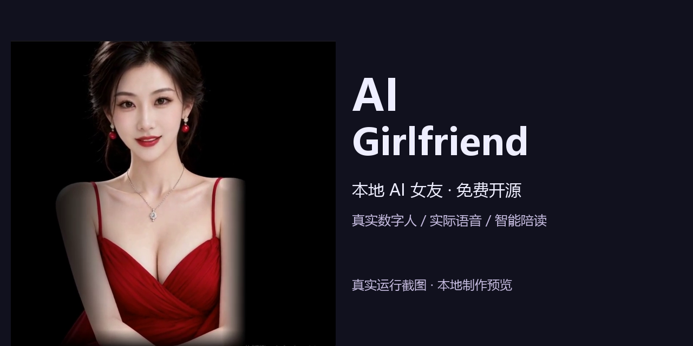

# AI 女友 V3 · 本地实时语音、数字人与陪读

[English](README_EN.md) · [安装](docs/INSTALL.md) · [AI Agent中文部署指引](docs/AI_AGENT_FULL_DEPLOYMENT_ZH.md) · [九类功能源码映射](docs/V3_CAPABILITY_SOURCE_MAP.md) · [测试边界](docs/TESTING.md)

**V3 开发预览源码发行版。** 本次同步当前生产已完成的可合法公开源码：中文交互、三LLM／三TTS切换、音色与书库管理、情绪控制、实时数字人、直播调度及认证服务管理。模型、原生引擎、人物、私人音色和数据均需自行合法准备。源码发布不等于开箱即用；**FRESH_INSTALL_E2E=HOLD**。

## 能力与源码

| 能力 | 核心路径 | 真实边界 |
|---|---|---|
| V3中文前端 | `runtime/ui/app/` | ROLEPLAY/READING、聊天／语音／数字人、设置、状态和错误提示，包含对应API |
| LLM管理 | `runtime/llm/`、`models_admin.py`、providers LLM manifest | DARK ROAST9B、Gemma4 12B、Qwen3 4B；单驻留、健康、冲突保护、事务回滚；权重另取 |
| 三TTS | `runtime/s2s_business/`、`runtime/core/providers/`、`runtime/higgs/higgs_worker.py` | Qwen3-TTS Base1.7B、Higgs v3 Q4、Fish S2 Pro；真实生成／分段／结束／取消／切换，DLL与引擎另取 |
| 音色库 | `voice_library_admin.py`、`ui/voice_library.js` | 上传、CPU ASR、文本修正、Higgs逐请求参考克隆、试听／激活／软删除／恢复；Qwen启动级参考，Fish外部命名音色 |
| 情绪 | `providers/manifests/tts.json`、`providers/delivery.py`、`ui/girlfriend.js` | 标签、原生推理、主观听感分别记账，不虚构统一情绪指令接口 |
| 数字人／实时语音 | `runtime/avatar/app/`、独立`avatar-sync.js`、`audio-router.js` | WebRTC、会话、音频回执／边界、重连／中断、Wav2Lip256外围；合法模型和自己的Avatar另取 |
| 智能陪读／书库 | `runtime/reading*/`、`reading_admin.py`、`ui/reading*.js` | 导入／章节／A-B-C策略／原文TTS／进度／跨段／暂停恢复／删除批删／冲突保护／回收站 |
| 直播互动 | `runtime/live/`、`runtime/ui/app/live_interaction.js` | 8781解析／去重／队列／调度，8888外部采集，AI回应至数字人播放；无礼物自动回复承诺 |
| 正式服务管理 | `runtime/ui7860_manager/`、`scripts/Manage-Project-Service.ps1` | 独立可见控制台、HMAC、UUID/PID/创建时间/路径核对、忙时拒停、排空、超时不强杀 |

架构：浏览器→7860同源API；8090本地LLM；8765语音会话／TTS；8010 LiveTalking/WebRTC；8781直播调度←8888外部采集。Higgs7077／Fish3030按需运行，TTS至多一个驻留。用户主要访问 http://127.0.0.1:7860 ，不合并实际服务端口。

## 情绪最终裁决（2026-10-16）

- Higgs **亲昵带刺（affection）／笑意调侃（amusement）**：作者用户试听通过，复用已有菜单，无新增按钮；这不是新声样、新机器的质量保证。
- 严厉／强硬（determination）保留，明确存在音色漂移；温柔、耳语、愤怒等原有控制保留。disgust原生选项保留但不作为目标尖酸效果宣传，不再优化；没有正式sarcastic标签。
- Fish温柔`[soft tone]`、耳语`[whisper]`保留；`[sarcastic]`本地未确认，停用、不宣传。
- Qwen3 Base保持声音克隆定位，不宣传独立情绪指令已验证；Higgs菜单不会自动应用到默认Qwen。
- 未找到历史情绪Skill原件，不能宣称“已恢复”。私人试听WAV不公开。

## 部署入口

先按[安装指南](docs/INSTALL.md)配置独立venv、合法依赖、模型、自己的参考音／Avatar及手动任务，再运行仓库根目录 **Start-AI-Girlfriend.cmd**。7860正式启停只通过认证管理器，不把直接uvicorn作为主要部署路径。

默认组合：DARK ROAST9B＋qwen3＋**自己的默认参考音**。发行包不包含作者“小烟”，历史`xiaoyan`只保留兼容ID。初始化和合成测试参考脚本不复制任何用户数据库。

## 验收范围

作者现有环境已验证三LLM／三TTS切换与推理、音色克隆链、书库管理和本地模拟直播；本轮发行另行执行源码／配置／关键导入、隔离业务和前端回归。详细状态及限制见[TESTING](docs/TESTING.md)，不把历史证据升级为新机器验收。

`LOCAL_LIVE_E2E=PASS`（作者现有环境历史）；`REAL_PLATFORM_FRESH_EVENT=HOLD`；`FRESH_INSTALL_E2E=HOLD`。普通聊天吞尾字历史故障复测NOT_REPRODUCED，不能声称已定位根治。实际声音相似度和浏览器全链路必须逐环境测试。

## 演示、许可与隐私

[110秒真实演示](docs/media/AI_Girlfriend_Real_Demo_110s.mp4) · [30秒演示](docs/media/AI_Girlfriend_Short_Demo_30s.mp4) · [数字人截图](docs/media/screenshot_avatar.png) · [陪读截图](docs/media/screenshot_reading.png)

以上五份既有媒体仅获**本GitHub项目展示许可**，不是可复用素材，不得训练、克隆、换脸、再发布或提取身份素材，详见[MEDIA_USAGE_POLICY](docs/MEDIA_USAGE_POLICY.md)。本轮没有上传新的真人媒体。

自研代码按MIT；LiveTalking及speech-to-speech派生按Apache-2.0并保留原许可；模型、原生引擎和受限媒体分别适用各自条款。Higgs与Fish模型研究／非商业及商业许可条件见[来源清单](provenance/MODEL_AND_ASSET_SOURCES.csv)、[NOTICE](NOTICE.md)。旧无许可证avatar适配器仍排除，仓库保留已审查的独立实现。请勿把整个工程、模型和媒体统一视为MIT。
