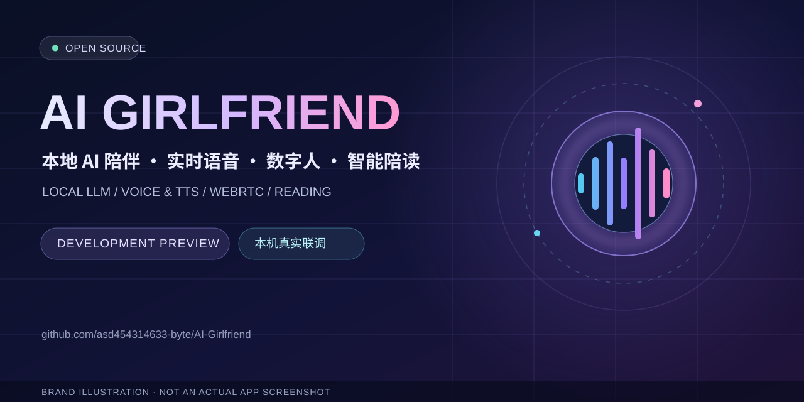

# AI Girlfriend — Local AI Companion



**Open-source local AI companion research project:** local LLM integration, real-time voice, a WebRTC digital avatar, intelligent reading, and independently testable frontend session controls.

**Choose a starting point:** [Feature overview](#what-is-in-the-repository) · [Quick verification](#quick-start-inspect-without-installing-large-models) · [Windows installation notes](docs/INSTALL.md) · [Validation limits](docs/TESTING.md) · [Chinese detailed README](README.md).

> This cover is a **concept-brand illustration, not product footage**. Video and screenshot candidates exist in the repository, but this homepage revision has not completed a frame-by-frame privacy and usage-rights review. They are intentionally not embedded as demonstrations or acceptance evidence.

**Local LLM · Real-time speech · WebRTC digital avatar · Intelligent reading**

[中文 README](README.md) · [Quick start](docs/QUICKSTART.md) · [Architecture](README.md#三整体架构与数据流) · [Test scope](docs/TESTING.md) · [Contributing](CONTRIBUTING.md)

> **Development preview, not a turnkey application.** This is a privacy-filtered, open-source code archive for an AI companion. Model weights, private avatars, reference voices, personal books, and user memory/chat data are deliberately excluded. The original third-party-derived avatar adapter is not redistributed; this repository includes a separately implemented frontend adapter.

## What is in the repository?

| Area | What it does |
| --- | --- |
| Conversational mode (ROLEPLAY) | Character/context assembly, chat UI, speech pipeline, locally hosted language model integration |
| Reading mode (READING) | Sends the original book text to TTS without LLM rewriting; segment planning, playback progress and cancellation |
| Digital avatar | LiveTalking backend + separately implemented WebRTC frontend adapter; streams rendered audio/video |
| Audio routing | Chooses local/browser vs avatar playback, correlates response and segment receipts, handles cancellation |
| Model providers | A modular approach to local LLM, speech recognition, voice synthesis and avatar backends |

### What has been tested?

Five offline adapter contract suites passed. According to the author's **October 13, 2026 local execution report**, the public adapter also passed T1–T6 live integration checks using an existing LiveTalking/8010 service: WebRTC connection, audible audio, decoded video, observed mouth motion, three-part reading, cancellation/reconnection and session cleanup (230/230 test sessions released).

**Important limits:** This was **not** a fresh-install test or an independent third-party reproduction. Microphone interruption was not tested. Full feature/performance parity with the private production adapter has not been established. A 1.5-second fail-open receipt window can occasionally produce duplicate audible output under severe browser-main-thread stalls.

[Detailed test report](docs/AVATAR_SYNC_REAL_ACCEPTANCE_20261013.md) · [Testing scope](docs/TESTING.md)

## Architecture overview

- **Web UI / local API** — port 7860
- **Local LLM** — commonly port 8090; can be stopped independently and is not needed for direct reading TTS
- **Speech-to-speech / TTS** — port 8765
- **LiveTalking avatar / WebRTC** — port 8010

The ports describe one documented local deployment, **not** hosted public services. See [installation notes](docs/INSTALL.md) and [the full Chinese architecture documentation](README.md#三整体架构与数据流).

## Quick start: inspect without installing large models

Install Node.js as needed; from the repository root:

```powershell
cd runtime/ui/app
node test_avatar_sync_session.cjs
node test_avatar_sync_session_reuse.cjs
node test_avatar_sync_lifecycle.cjs
node test_avatar_sync_ice.cjs
node test_avatar_sync_reading.cjs
```

These are offline contract tests, **not** proof that the complete system can start without external models. Review [the quick-start guide](docs/QUICKSTART.md) before attempting a full installation.

## Licensing and personal-data boundary

Only code identified as original is offered under the top-level MIT license. Third-party components retain their respective terms and notices; the overall repository is **not** a blanket MIT relicense. Wav2Lip lineage includes non-commercial restrictions. See [LICENSE](LICENSE), [NOTICE](NOTICE.md) and [model/resource manifest](provenance/MODEL_AND_ASSET_SOURCES.csv).

No genuine personal conversation archives, books, avatar assets, raw voice samples or model weights are included. Please do not submit such materials in issues or pull requests.

## Contributing

Bug reports and reproducible tests are welcome. Please see [CONTRIBUTING.md](CONTRIBUTING.md). Demo recordings and screenshots of the real app will be added only after consent and privacy/licensing checks; any existing banner is **illustrative branding, not a real screenshot**.

**Repository:** https://github.com/asd454314633-byte/AI-Girlfriend
